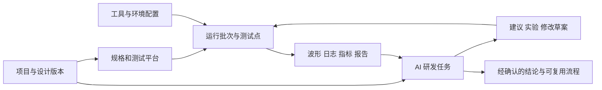

# Linux IC AI 研发工作平台 · 完整需求草案

更新：2026-09-21（Asia/Shanghai）。本文件保留完整业务需求；第一版实现状态以 COMPLETION_REPORT.md 为准，不把长期需求清单当作已实现能力。

用户最新要求：**按第一版方案开发并验证，目标 CentOS 6.9 x86_64、GLM 接口可配置，生产/Demo 分开；未验证项说明原因。** 第一版范围见 [V1_SCOPE.md](docs/V1_SCOPE.md)，已授权实施；本稿保留全部业务需求，不因首版取舍删除长期范围。历史分期和 MVP-01～06 不重新生效。

2026-09-23 交付方式调整：用户要求删除独立 Demo 安装包，Demo 改为本机网页预览；复用正式界面与模拟执行后端，继续保持配置/数据/凭据隔离。生产 Linux 候选包保留。

## 2026-10-24 GitHub 源码上传

用户要求将已完成的项目上传 GitHub，且尚未建立仓库。以项目名 `linux-ic-workbench` 在已验证账号 Dr-xiaowei 下建立私有仓库：https://github.com/Dr-xiaowei/linux-ic-workbench 。保留 0.8.0-rc3 候选标识；不创建正式版本或公开许可。源码、依赖、测试、脱敏验证记录和当前精简安装包上传；本地运行数据、密钥、QEMU/模型环境、公司申报材料和历史安装包不上传。

## 2026-09-26 原生客户端与小模型（最新确认，覆盖旧浏览器交付）

生产 Linux 必须是原生桌面客户端，不能以浏览器/WebView 替代。网页仅用于 Demo。原生十页继续复用持久数据、业务与权限；以真实小模型分别验证问答、文件分析、Code 生成/优化/修复、平台 Agent、Linux Agent 和 EDA MCP 协议工作流。需要记录失败，不能将模型成功返回等同于任务通过。CentOS 6.9 x86_64、低资源、终端安装启动、双用户隔离、升级保留数据继续有效。详见 [原生客户端](docs/NATIVE_DESKTOP.md)。

## 2026-09-26 命令安装与 GUI 验收（已确认）

完成 Linux 普通用户命令安装，增加 `--open` 命令直接打开 GUI；桌面/VNC 使用默认浏览器，SSH 使用转发访问。必须实际验证渲染与操作、重复打开、升级保留数据，完成后停止专用测试服务但保留全部环境文件，用户 Demo 保持运行。说明见 [终端 GUI 验收](docs/TERMINAL_GUI.md)。

## 2026-09-26 Linux Agent（本轮已确认）

AI 对话增加自主控制 Linux 的工具循环，使用当前 Linux 账号执行非交互命令、读写文件、创建目录，展示实时输出/退出码/取消与持久回执。授权仅本轮有效，默认关闭终端操作，可逐项确认或自主执行；工作目录不是 OS 沙箱。Demo 只模拟。保持原有 CentOS、多用户、升级和数据边界。实现说明与工程适用性评估见 [Linux Agent](docs/LINUX_AGENT.md)，新建议单独列为待评估，不自动加入已确认范围。

## 2026-09-26 验证范围

本轮补充：加强并发、存储故障、异常退出与升级验证；不同 Linux UID 共用程序时必须独立配置/数据/端口/令牌；增加终端启动和当前实例查询。用户继续保留验证环境，未授权清理。实现与证据见 [可靠性复验](docs/RELIABILITY_RC3.md)。

用户授权在项目内用 QEMU 最小 CentOS 6.9 x86_64 和本地小模型验收所有非 EDA 功能，真实 EDA 工具调用本轮排除。验证工具、模型、镜像与虚拟磁盘只放在 `reference-sandbox/linux-validation/`，最终清理须等用户明确确认。验证数据独立于现有 Demo/个人工程。

## 2026-09-25 本轮确认：EDA 任务与代码闭环

- 公司已负责内网工程备份，取消平台项目/个人快照的手动备份功能与 Agent 入口。项目仅登记路径、备注、标签及配置，不复制工程。旧数据/备份保留；必要的 schema 迁移只保留元数据恢复文件。此条覆盖历史 OPS-05、SIM-07 中的备份建议。
- EDA 控制新增任务对话：固定当前 MCP 软件连接及允许工具，AI 按任务调用、读取状态，原页实时展示阶段、原生进度和回执，支持取消与刷新恢复。
- **IDEA-09 已纳入：** 检查 → 根据工具错误证据限次 AI 修复 → 复检，1–3 次修复预算，保留原文，候选审阅后采用。
- **IDEA-10 已纳入：** 轻量诊断定位、按需格式化和选中行格式化。全量 LSP、符号导航仅为后续方向。
- IDEA-11 已于 2026-09-29 纳入多文件修改集（本轮不自动 Git 提交）；IDEA-12 增量备份不纳入，按用户取消备份的决定处理。

实现基线 0.5.0-rc1 / Schema 6，详见 [本轮指南](docs/EDA_TASKS_AND_CODE_CHECKS.md) 和完成报告；目标公司环境未验收的部分不作为已验证能力。

## 2026-09-25 本地数据与代码修改（已确认）

所有平台个人记录和配置偏好必须在工作台所在机器本地保存，与安装版本目录分离；升级复用已有目录且不得清库。Code 草稿/导入原文/AI 建议、文件分析历史/结果、计算器和未发送的问题加入持久化。避免复制整个项目或无限追加自动保存快照，压缩草稿（旧的备份去重功能在 0.5 按用户要求取消），并显示实际占用；保存失败和多页面冲突可见。源工程与外部脚本保持原位置，凭据仍由启动环境提供。

Code 平台支持导入常用代码文本，AI 根据当前代码与修改要求返回候选，用户对比后采用、可撤销并另存/导出；不得把模型返回当作仿真或性能验证。本轮实现基线 0.4.0-rc1 / Schema 5。新 GitHub 建议见 [候选报告](docs/GITHUB_RESEARCH_V4.md)，当时待判断；现已确认 IDEA-09/10，状态以本轮段落为准。已确认 IDEA-01～08 继续有效。

## 2026-09-25 页面职责调整（已确认）

HDL 改为 Code 平台并扩展常用电路代码种类；文件 AI 分析结果在当前页面显示；增加常规/公式/变量计算器；仅 AI 对话提供项目或文件夹操作范围；项目与文件只管理文件，移除结果/任务/优化页签（历史数据保留）；独立 EDA 控制页面通过 MCP 连接厂商适配器与外部服务。维持浅绿色、轻量双语、Linux 与网页 Demo 分离。实现基线升为 0.3.0-rc1 / Schema 4，接入边界与验收见 COMPLETION_REPORT.md。

## 2026-09-23 重构要求（已确认，覆盖旧首版分组）

以八个独立工作区重做 Linux 和网页 Demo：项目多路径/图形浏览/逐文件说明与全项目关键词检索；统一 AI Agent 和实时进度；软件统一启动命令与版本环境；个人插件及脚本批量安装；CPU/GPU/内存/存储阈值监测和仿真任务关闭；Virtuoso/DC/Calibre/VCS 文本及波形分析；双栏 HDL 生成、导出与配置编译；模型/Linux 环境启动和保存后加载验证。用户确认 VS 指 VCS。

实现基线为 0.2.0-rc1 / Schema 3。详细行为、限制和使用方法见 [V2_GUIDE.md](docs/V2_GUIDE.md)，实际验收结论以 COMPLETION_REPORT.md 为准。

## 1. 产品目标与已知事实

平台核心是通过 AI 赋能 IC 研发。建议完整定位：以公司内网模型服务为 AI 接入基础，理解项目上下文，连接 EDA 工具、设计资料、仿真与验证结果，帮助工程师完成可追溯的研发任务。

| 编号 | 用户已确认的方向或事实 | 当前边界 |
| --- | --- | --- |
| DIR-01 | 项目独立放在 AI_personal_workspace 子目录 | 已建立 linux-ic-workbench 与本地 Git |
| DIR-02 | 开发 Linux 工作平台 | CentOS 6.9 x86_64 已确认；回环网页服务/SSH 转发，目标机尚未验收 |
| DIR-03 | 包含软件、设计项目、个人文件夹管理和 AI 辅助 EDA | 各模块细化方案尚未逐项确认 |
| DIR-04 | 开发思路和 UI 尽量参考 DeepSeek Harness | 不等于确认复用其源码、技术栈或模型绑定 |
| USR-01 | 公司与主要使用者以模拟 IC 为主，同时支持数字 DE 和版图工程师 | 多岗位支持已确认；多人协作、统一服务与权限体系待确认 |
| MOD-01 | 公司 Linux 内网已部署 GLM 5.3 | 用户提供的部署事实；未连接服务，不推定接口、模型能力、容量和数据政策 |
| CORE-01 | AI 赋能研发是平台核心 | AI 贯穿项目、工具、数据、分析和知识复用，具体执行权限待确认 |
| SIM-01 | 仿真数据输出、导出与管理是明确痛点 | 包括哪些格式、体量与结果类型待细化 |
| DBG-01 | 需要 debug 芯片仿真结果 | 覆盖运行失败和结果/指标异常；具体场景待采样 |
| AI-01 | 希望 AI 提升 EDA 效率，包含工艺平台迁移 | 迁移范围与自动化深度待确认 |
| ENV-01 | 软件版本切换时反复修改 .cshrc 等配置文件 | 实际 shell、既有脚本与配置组织待确认 |
| PROC-01 | 先整理完整需求，再制定阶段开发计划 | 完整需求已整理，按首版八组范围推进实现与验证 |
| ANN-01 | 项目文件管理，能给自己的项目添加备注与标签 | 已确认需求；细化见 PRJ-07～PRJ-09，文件级标注为建议扩展 |
| MCP-01 | 增加 MCP 以控制 EDA，并评估其他控制方式 | 已确认接入方向；具体工具和动作需逐项验证，不意味着所有 EDA 已可控 |
| OPT-01 | 辅助模拟芯片设计调参数，自动迭代优化 | 已确认需求；目标、变量、约束、计算预算及设计写回策略待确定 |
| UPG-01 | 平台软件升级保留之前的数据，仅更新功能 | 已确认硬性要求；必要格式迁移必须保留信息，不能清库、重置或清理用户数据 |
| LANG-01 | 提供英文和中文两种语言模式 | 已确认；界面范围与切换验收见 UX-06，具体呈现方案待设计 |
| PERF-01 | Linux 下 UI 低资源占用，避免平台开销导致公司服务器卡顿 | 已确认性能要求；覆盖 UI 及其触发的后台工作，资源预算和允许影响需依据目标环境量化，详见 PERF-02～04 |
| REL-01 | 开发与交付区分正式版和 Demo | 已确认；入口、配置、数据与产物隔离，共用业务实现，Demo 的模拟/回放能力不冒充真实验证 |

后文“已确认方向细化”表示业务诉求已获用户确认，但设计细节仍是建议；“建议补充”表示尚未确认纳入范围。候选需求进入清单不代表开发承诺。

### 1.1 已确认纳入的调研建议（2026-09-21）

用户确认将 GitHub 调研提出的八项建议全部纳入业务范围。以下映射是正式需求的一部分，各项验收在对应功能章节维护；不表示已选择参考项目为依赖、已实现功能或已确定开发顺序。其余未涉及的建议项仍保留原状态。

| 调研编号 | 已确认能力 | 正式需求映射 |
| --- | --- | --- |
| IDEA-01 | 变更影响与结果有效性提醒 | PRJ-10 |
| IDEA-02 | 参数重要性与局部敏感度分析 | OPT-11 |
| IDEA-03 | 多目标候选对比面板 | OPT-02、OPT-08 |
| IDEA-04 | 分级仿真与提前淘汰 | OPT-12 |
| IDEA-05 | 实验分支与选择性重跑 | RUN-05、AUT-04、SIM-05 |
| IDEA-06 | 评审证据包与例外记录 | OUT-02，关联 PRJ-02、PRJ-04 |
| IDEA-07 | AI 回归样本库与版本对比 | AIC-08、AUT-05、质量与升级验收 |
| IDEA-08 | 远端 EDA 会话卡片 | RUN-07，关联 RUN-04、OPS-01 |

远端会话能力已纳入，接入公司现有远程桌面/门户/调度服务的方式仍待核实，不默认建设新的远程桌面基础设施。调研来源与历史判断见 [GitHub 调研报告](docs/GITHUB_RESEARCH.md)。

## 2. 服务对象与工作范围

| 对象 | 希望平台帮助完成的工作（细化建议） | 需要关联的数据 |
| --- | --- | --- |
| 模拟设计工程师 | 规格与测试整理、仿真配置、数据导出、指标比较、debug、工艺迁移 | 电路/测试平台背景、PDK、工作点、波形、PVT/MC、测量表达式 |
| 数字 DE | 设计/验证脚本、编译与回归排错、波形定位、时序分析与结果整理 | RTL/测试平台、日志、回归条件、断言、时序约束和报告 |
| 版图工程师 | 版图交接、DRC/LVS 问题整理、寄生提取和前后仿关联、迁移评估 | 版图版本、规则版本、检查报告、定位信息、提取配置与网表 |
| 跨岗位项目参与者 | 共享一致的设计版本、问题记录、交接资料与结论 | 规格、变更、相关任务与可访问的结果引用 |
| CAD/IT 维护者（建议角色） | 配置软件/模型接入、核对环境、维护适配器和服务 | 工具版本、服务器、授权配置引用、运行状态；是否需要独立角色待确认 |

“数字 DE”的公司实际职责范围待确认；不默认所有数字工程师都负责验证、后端实现及签核。支持岗位共用流程不要求每个岗位都看到同样的默认界面。

### 已知软件清单

以下软件均由用户提供，全部保留为目标适配范围；当前无任何已实现适配。版本、自动化接口和许可证待核实。

| 分组 | 工具 | 需求接入面（建议） |
| --- | --- | --- |
| 模拟设计与仿真 | Virtuoso、Spectre | 设计上下文、仿真任务、结果导出、工作点/波形、脚本 |
| 华大九天系列 | ALPS、Aether、Demeter 等 | 分别登记版本、环境、项目与输出，按产品能力适配 |
| 物理验证与提取 | Calibre、StarRC、XRC | 检查/提取任务、报告、结果定位、前后仿关系 |
| 数学分析与 RF | MATLAB、ADS | 分析/后处理脚本、输入输出与指标结果 |
| FPGA | Vivado | 工程环境、运行任务、日志和报告 |
| 数字仿真、时序与 debug | VCS、PrimeTime、Verdi | 编译/回归、debug、时序和波形访问 |
| 数字实现 | Innovus | 实现任务、日志/报告与结果管理 |

Innovus 按 Cadence 产品登记，与 Synopsys 的 VCS、PrimeTime、Verdi 分开；来源见 REFERENCES.md。XRC 确切产品/模块仍待确认。不得假定不同厂商脚本或数据格式互通。

## 3. AI 如何贯穿研发工作

建议把一次 AI 工作组织为“研发任务”，并关联明确的目标、上下文、动作和结果：

**提出目标 → 选择/检索上下文 → 形成方案 → 按授权调用工具 → 读取实际结果 → 核对与修正 → 工程师验收 → 沉淀可复用方法。**

工程师可以从对话发起任务，也可以在项目页、结果表或文件上选择“让 AI 分析/处理”。普通界面操作与 AI 操作使用同一份项目和结果数据。

| 能力层 | 业务需求 | 行为与验收边界 |
| --- | --- | --- |
| 理解与检索 | 理解当前项目、软件、工艺、设计阶段和问题 | 可查看本次使用的上下文；不把其他项目资料带入当前任务 |
| 分析与建议 | 分析报告、指标、脚本与设计问题 | 引用来源，区分事实、假设及缺失信息 |
| 生成与修改 | 生成脚本、映射表、测试定义、说明和修改方案 | 展示目标文件、内容差异、影响与验证方法 |
| 调用与执行 | 调用受支持的 EDA/分析工具完成操作 | 在实际执行环境中记录命令/参数、状态和产物；模型回复不是执行成功证据 |
| 验证与迭代 | 根据真实结果修正脚本或提出下一次实验 | 有时间、计算资源、许可证和迭代次数边界；避免失败后无约束反复重跑 |
| 经验复用 | 把有效方法保存为模板、工作流或知识条目 | 区分 AI 草稿与工程师确认内容；保留适用版本和验证记录 |

这些是能力层次，不是开发阶段。AI 可以做到哪一层由用户授权、任务风险及接入工具共同决定。

## 4. 完整功能需求目录

### 4.1 AI 工作台与内网模型

来源：CORE-01、MOD-01 已确认；IDEA-07 的 AI 回归样本库已确认纳入 AIC-08，其余接入及交互细节待确认。

| 编号 | 细化需求 | 可验收结果 |
| --- | --- | --- |
| AIC-01 | 接入公司内网 GLM 5.3 服务 | 能验证连接、身份与实际服务模型；接口错误、超时和不可用有明确反馈 |
| AIC-02 | 按项目保存 AI 会话、研发任务和结论 | 恢复任务后可查原始上下文与产物，跨项目内容不混淆 |
| AIC-03 | 从文件、指标表、报告或批次选择 AI 上下文 | 发送前可见所选材料及范围；大文件采用检索/摘取并标出缺失或截断 |
| AIC-04 | 自然语言驱动已支持的操作 | 显示将执行的动作和实际状态；未知工具/不支持动作不伪装为已完成 |
| AIC-05 | 控制任务执行与人工介入 | 可暂停后续步骤、停止/取消已支持的作业、修改目标并查看已发生的影响 |
| AIC-06 | 配置和记录模型使用情况 | 记录模型/服务版本、耗时、错误；用量仅在服务提供数据时显示，不虚构 token 数 |
| AIC-07 | 内网数据路径与服务可用性 | 建议默认使用经批准的内网服务，不静默回退外部 API；模型离线时管理功能可用 |
| AIC-08 | AI 回归样本库与版本对比（已确认纳入） | 固定内网样本、预期事实和判定规则；记录模型/端点、提示词、工具 schema、解析器及样本版本；升级前后比较取数准确性、诊断、错误操作率与耗时，保留旧基线及多次运行波动 |
| AIC-09 | 独立内网 AI 对话界面（已确认，首版纳入） | 无需创建/选择项目或启动 EDA 即可向内网 GLM 提问、多轮追问并查看会话历史；可新建、重命名会话、复制回答及停止界面接收，服务端取消能力另行验证；服务不可用有明确提示，不静默转外网 |

独立问答与项目助手有清楚入口和上下文标识，共用模型连接与会话基础能力。普通问答不自动附带项目、扫描文件或调用 EDA；用户选择关联项目/材料并进入受控任务后，才按已有授权执行工具。首版支持文本问答与代码/公式等基础排版，中英文界面均覆盖；流式输出以 GLM 接口支持为前提，停止展示不伪称已停止服务端推理。通用问答不伪造资料引用，只有实际检索/用户提供的材料才作为来源引用。

AI 回归样本覆盖日志诊断、结果导出、失败恢复、错误工具参数和越界路径；以可核对事实/规则和人工标注为依据，不能完全依靠同一模型自评。执行测试使用隔离的测试数据与目标，不写回真实设计；数据保留和工具行为回归分别验收。

GLM 接入待核实项：协议、服务地址、认证、流式输出、工具调用/结构化输出、上下文长度、并发和限流、图片/文档输入、任务取消、日志留存。内网服务可用不代表这些能力全部具备。知识检索所需的 embedding/rerank/OCR 等能力单独确认，不默认 GLM 端点同时提供。

### 4.2 软件、环境与版本

来源：ENV-01 已确认；实现方式未定。

| 编号 | 细化需求 | 可验收结果 |
| --- | --- | --- |
| ENV-02 | 软件目录：工具、版本、路径、主机、用途与启动方式 | 可核对实际可执行文件及版本，工具不可用时能解释原因 |
| ENV-03 | 项目绑定命名环境配置 | 切换版本无需反复修改全局 .cshrc；旧进程不受新配置影响 |
| ENV-04 | 兼容既有 shell/脚本、PDK、库和授权配置 | 保留必要公司基础环境；配置引用可核对；敏感值不进入模型上下文 |
| ENV-05 | AI 辅助环境诊断与配置解释 | 识别路径/版本冲突，提供差异和修改建议，实际验证后再标记修复 |
| ENV-06 | 环境复现与兼容组合记录 | 同一任务能找到原工具/PDK组合；不可复现或配置已失效时明确提示 |

建议用独立启动进程加载环境，不修改已运行软件的环境。不仅核对 PATH，还需关注库定义、模型引用和工具初始化文件。csh/tcsh 的 alias 与 shell 内建行为不能仅靠复制环境变量恢复。独立进程环境不等于操作系统安全沙箱。

软件安装、升级、自动探测范围、许可证余量查看均为待确认补充，不擅自管理公司授权服务器。

### 4.3 项目、规格与设计上下文

来源：DIR-03 已确认项目管理；IDEA-01 的变更影响提醒、IDEA-06 涉及的规格—证据—例外关联已确认纳入；其他规格/交接扩展仍按原建议范围处理。

| 编号 | 细化需求 | 可验收结果 |
| --- | --- | --- |
| PRJ-01 | 登记项目、芯片、模块、测试平台与现有目录 | 可恢复项目结构与关联资料，不强制搬动原件 |
| PRJ-02 | 维护规格、测量定义与验证项的关系 | 每项指标能关联表达式、测试条件、规格版本和结果 |
| PRJ-03 | 管理设计版本、配置快照和变更说明 | 结果能定位到明确版本/快照；只有路径/时间戳时标记证据不足 |
| PRJ-04 | 关联问题、AI 任务、设计决定和待验证事项 | 找到问题的依据、处理过程与验证结果，避免结论只留在聊天中 |
| PRJ-05 | AI 辅助设计阅读、变更总结和交接 | 对允许访问的设计材料提供有来源的摘要，不自行补造缺失设计意图 |
| PRJ-06 | 可选的人员、里程碑和共享视图 | 仅在确认团队协作范围后实施，已有共享盘不自动等同于所有人有权访问 |
| PRJ-07 | 为自己的项目新增、修改备注 | 支持多行说明、时间与修改记录；重启、升级后内容不丢失，默认属于本人 |
| PRJ-08 | 项目自定义多标签、筛选和搜索 | 一个项目可有多个标签，按标签/备注查找；标签改名和移除不影响项目原件 |
| PRJ-09 | 项目标注与目录引用稳定关联 | 标注以稳定项目 ID 关联；目录迁移/重新定位后保留，重名目录不误合并，路径失效不自动删标注 |
| PRJ-10 | 变更影响与结果有效性提醒（已确认纳入） | 设计、PDK/模型、工具或测试/测量定义变化后，沿依赖关系列出需重验的指标、报告与候选及理由；依赖不足标未知，保留结果在旧基线下的历史含义；仅改备注不使仿真结果失效 |

变更提醒可生成重验清单，但不自动提交全部重跑；是否执行沿用任务授权与预算。需区分“针对新基线需要重验”和“旧结果本身无效”，不得通过覆盖旧记录消除差异。

项目文件管理补充：在项目内浏览、检索和定位资料，并显示项目备注与标签。建议可进一步给文件/子目录标注，但用户当前明确的是项目级备注与标签，文件级范围单独确认。AI 可以提出备注、标签与摘要建议，不覆盖用户原有说明；是否共享标签、是否允许自动写入另行确定。标注元数据建议与设计原件分离，纳入导出和升级迁移（平台备份现已取消）。

### 4.4 仿真与验证任务

来源：用户仿真/EDA 效率需求的细化；自动优化由 OPT-01 确认，详见 4.13；IDEA-05 的实验分支/选择性重跑与 IDEA-08 的远端会话卡片已确认纳入。通用调度系统接入仍为建议，实际会话和作业接口按公司环境确定。

| 编号 | 细化需求 | 可验收结果 |
| --- | --- | --- |
| RUN-01 | 管理任务输入、测试配置、主机和环境 | 运行前能查看工具、版本、工作目录、输入和预计动作 |
| RUN-02 | 管理测试组合与重复实验 | PVT、扫描、MC 等按实际场景配置；每个测试点有独立标识和状态 |
| RUN-03 | 查看运行中、完成、失败、取消和部分完成状态 | 区分启动器退出、后台任务完成及设计达标，状态可由真实日志/作业查询核对 |
| RUN-04 | 处理长任务、断线与恢复 | 明确关闭窗口后是否继续；重连不重复提交；取消行为因工具而异并可验证 |
| RUN-05 | AI 实验建议、实验分支与选择性重跑（分支/重跑已确认纳入） | 从历史基线派生参数/配置分支，保留父实验、差异与假设；只重跑必要测试点，生成新记录并关联原失败证据；标明新算/复用结果及预计成本，不强制复制整个工程或大型波形 |
| RUN-06 | 对接现有队列/调度与资源约束（建议） | 与公司现有方式相容；不预设 Slurm/LSF 或其他系统，记录任务所有权 |
| RUN-07 | 远端 EDA 会话卡片（已确认纳入） | 项目内显示实际服务器、软件版本、图形会话、关联作业及可获得的资源/到期状态；可定位原会话并按接口能力重连，未知信息明确标示，不因重进工作台重复启动 EDA 或提交作业 |

实验复用必须核对设计、PDK/模型、工具、输入、测试条件、测量定义以及随机种子/实际样本标识和运行背景；原件缺失或完整性无法核实不视为可复现。浏览器连接、图形会话与计算作业有各自生命周期，分别报告可恢复、已结束或未知状态；会话恢复不等于 MCP 可操作任意 GUI 控件。

### 4.5 仿真数据、结果与导出

来源：SIM-01 已确认；数据管理细节待确认。

| 编号 | 细化需求 | 可验收结果 |
| --- | --- | --- |
| SIM-02 | 登记已有结果和平台发起任务的结果 | 保存项目→测试平台→批次→测试点→产物关系，重复登记可识别 |
| SIM-03 | 提取/导出标量指标、指定波形和报告 | 保留原值、单位、精度、选择范围、来源与导出方法；失败有清晰记录 |
| SIM-04 | 汇总 PVT/扫描/MC 及规格判定 | 缺失、未计算、失败不能当作 0 或通过；统计口径、有效/无效样本可追溯 |
| SIM-05 | 比较设计版本、实验分支、工况与前后仿结果 | 显示基线、参数差异、测量定义、单位与条件，以及新算/复用标记；不兼容时不产生误导性的直接比较 |
| SIM-06 | 结果检索、标注、筛选、绘图和报告 | 从异常指标定位对应测试点、日志和原始波形；图表保留条件与单位 |
| SIM-07 | 结果保留、归档、空间与备份管理（建议） | 区分索引与备份；原件失效可识别；清理有范围预览且不误删当前结果 |
| SIM-08 | 接入 MATLAB/其他既有后处理 | 保存输入、脚本版本、执行环境和输出关系，便于追溯和复算 |

原始波形、标准化指标和导出文件分别管理。不会仅凭格式扩展名推定可解析；不预设将所有大波形转成 CSV。正在写入的数据标记为不完整。MC 的 seed 并非跨版本/跨工具完全复现的充分条件，还需保留实际样本与运行背景。

### 4.6 AI 仿真与设计 debug

来源：DBG-01 已确认；具体分析深度依实际证据与工具能力确定。

| 编号 | 细化需求 | 可验收结果 |
| --- | --- | --- |
| DBG-02 | 启动、网表、模型、授权与运行错误定位 | 引用日志/环境证据，区分实际原因与待验证猜测 |
| DBG-03 | 不收敛、数值异常和测量异常排查 | 区分设置问题、测量定义与电路行为，提供可执行的验证步骤 |
| DBG-04 | 指标不达标、波形异常与工作点分析 | 关联工况、表达式、信号区间和必要电路背景；证据不足时说明缺口 |
| DBG-05 | 版本回退/退化及前后仿差异分析 | 先核对可比性，再形成原因假设；相关性不冒充因果结论 |
| DBG-06 | 跟踪假设、实验与根因确认 | 记录哪些实验支持/否定假设，工程师确认后才形成已验证知识 |

AI 分析输出建议固定包含：观察事实、来源、原因假设、验证步骤、未知项。日志定位文件与行号；波形定位信号及时间/频率区间；指标定位批次、测试点和表达式。运行成功与性能达标分开判定。

### 4.7 工艺平台迁移

来源：AI-01 已确认；原理图、测试平台与版图覆盖深度待确认。

| 编号 | 细化需求 | 可验收结果 |
| --- | --- | --- |
| MIG-01 | 迁移可行性与源/目标工艺差异评估 | 明确输入、目标、限制、未掌握资料与不可映射项 |
| MIG-02 | 器件、端口、参数含义/单位与约束映射 | 映射可审阅并版本化，缺失项不静默填入默认值 |
| MIG-03 | 工程、模型引用和测试平台迁移 | 目标副本能按验证后的配置产生网表/运行测试，源工程完整保留 |
| MIG-04 | 性能重验证与参数调整建议 | 按源/目标规格与工况比较，不把同名器件或相同 W/L 当作电气等价 |
| MIG-05 | 版图层/PCell/设计规则及约束迁移评估 | 明确需工具支持和人工处理的项，层号替换不能代表完整迁移 |
| MIG-06 | 迁移任务与验证记录统一管理 | 映射、网表、仿真、指标、DRC/LVS、后仿分别记录结果与未决项 |

已有厂商迁移能力可作为候选执行方式，需核实实际版本、许可证与 PDK 支持。平台需求是辅助迁移和验证；不预设通用的一键自动迁移或自动完成签核。

### 4.8 数字 DE 与版图专业工作

来源：USR-01 已确认岗位覆盖；以下专用功能均为建议补充，需相关工程师评审。

| 编号 | 专用需求 | 可验收结果 |
| --- | --- | --- |
| DIG-01 | 数字工程/脚本与编译、仿真、回归管理 | 用例、版本、seed/参数、日志和结果可关联，失败分类可复核 |
| DIG-02 | AI 辅助 RTL/测试脚本阅读与 debug | 代码/日志/波形证据可定位，修改建议经对应工具验证 |
| DIG-03 | 时序约束/报告及实现结果分析 | 保留模式、corner、约束版本与路径信息，不用不同条件数据直接比较 |
| DIG-04 | FPGA 工程及结果管理 | Vivado 相关任务和报告可追溯，接入范围依岗位确认 |
| LAY-01 | 模拟设计与版图交接 | 关联端口、设计版本、匹配/屏蔽等约束、交接说明与待解决问题 |
| LAY-02 | AI 辅助 DRC/LVS 报告整理与定位 | 按规则和问题类型归类，保留原报告/定位信息，不能将 AI 判断当作 clean |
| LAY-03 | 寄生提取与后仿关联 | 提取版本、规则/配置、网表和后仿结果对应明确 |
| LAY-04 | AI 辅助布局/约束检查与修改建议 | 明确实际可读设计对象与工具支持，图形识别和自动布局不默认可用 |

### 4.9 脚本、工具适配与可复用工作流

来源：CORE-01、AI-01 的跨模块细化，MCP-01 已确认新增；工作流市场/复杂编排未确认。

| 编号 | 细化需求 | 可验收结果 |
| --- | --- | --- |
| AUT-01 | AI 辅助生成、解释、修改和检查研发脚本 | 语言和 API 与实际工具版本相符，保留差异、输入输出和验证结果 |
| AUT-02 | 明确每个工具已支持的操作与条件 | 分别显示启动、读报告、导出、修改等能力及已验证版本，不用“已接入”概括全部能力 |
| AUT-03 | 将成功操作保存为模板/Skill/工作流 | 参数、适用版本、权限、失败处理和验证证据完整；术语/实现形式待选型 |
| AUT-04 | 多工具流程与失败恢复 | 步骤/依赖可查看，失败可定位；选择性重跑仅复用已核对有效的依赖结果，保留历史状态与新运行记录；重试不重复覆盖产物或重复提交任务 |
| AUT-05 | 工作流版本、人工复核与复用 | AI 生成草稿与已验证模板分开，更新后旧任务仍可追溯原版本；提示词/工具/工作流变更关联 AIC-08 的回归结果，不能因版本更新自动标记为已验证 |
| MCP-02 | 平台支持发现、连接和管理经批准的 MCP 服务 | 展示服务、工具、连接状态和可用版本；失联/接口不兼容有明确提示 |
| MCP-03 | 通过 EDA 适配器提供具体操作 | 参数读取/设置、仿真提交、状态查询、结果导出等分别验证，不以 shell 可执行等同完整控制 |
| MCP-04 | EDA 会话、主机、项目与权限明确绑定 | 操作落在正确的设计/会话；参数检查在执行侧完成，不只依赖模型自律 |
| MCP-05 | 长任务、重试与取消可追踪 | 提交返回任务标识，断线可查询；重试不重复启动仿真，取消范围/结果能核对 |
| MCP-06 | MCP 与平台普通功能共用 EDA 执行能力 | 无模型时仍可通过界面/脚本使用同一适配能力，操作记录与权限一致 |
| MCP-07 | 先调研 GitHub 成熟方案，再执行适配（已确认） | 实现前按通用十项标准核查原仓库、锁定 tag/commit、许可证、维护/测试和已验证 EDA 版本；分别评价 MCP SDK 与 EDA 桥接层，记录直接复用/改造/自建比较。没有成熟证据的桥接保留为候选，不按成熟全栈方案执行 |

首条验证链路已由用户确定为 Virtuoso/Spectre：先核对 Virtuoso 会话与 ADE/工具版本、工作目录和测试平台，再验证约定脚本导出/网表、Spectre 提交与状态、指标导出及人工基线对照；仅独立运行一个 Spectre 网表不能代表 Virtuoso 联通已验收。链路范围先用一个工程副本，失败/重试/取消按真实工具核对。具体桥接选型仍待证据与实际版本匹配，未获得公司环境访问前不宣称已联通。

建议优先评估官方接口、已有脚本和受支持的命令；GUI 自动化是否必要由具体操作决定，不承诺所有 EDA 均能被统一遥控。

#### MCP 控制 EDA 的可行性与替代方式

结论：**有可行的技术路径，具体可控范围取决于 EDA 的实际接口、版本、运行会话与许可证。** MCP 提供工具发现与调用协议；适配器才负责把“设置参数、运行仿真”等动作转换为 EDA 可执行操作。协议接通不等于已经验证 EDA 控制。

建议关系：工程师/GLM → 平台任务编排与 MCP 客户端 → 内网 EDA MCP 服务 → 已验证的脚本/API/批处理适配器 → EDA → 真实结果。这里的 GLM 通过平台使用工具，不要求模型服务本身充当 MCP 客户端。GLM 的工具调用或可靠结构化输出能力仍需验证；不能直接执行任意模型文本作为命令。

| 控制方式 | 适合的操作 | 判断与限制 |
| --- | --- | --- |
| MCP 包装官方 API / 脚本接口 | 项目/设计上下文、参数、测试配置、数据导出 | 推荐评估；便于向 AI 提供明确动作，仍需逐工具适配和版本验证 |
| 平台直接调用 API、命令行或既有脚本 | 批量仿真、报告解析、后处理、固定工作流 | 可独立于 MCP 工作，也可作为 MCP 的共用执行层；能复用已有脚本时无需重写 |
| 工具内插件/会话桥接 | 控制已打开的工程、读取未导出的对象、把修改反映到 EDA 界面 | 可与 MCP 组合；需明确会话选择、未保存设计、锁定及并发编辑行为 |
| GUI 自动化 | 缺少脚本/API 的局部操作 | 条件性补充；依赖显示会话、窗口状态和版本，批量迭代优先采用可验证接口 |

已核实的公开依据：Cadence 官方资料描述 OCEAN 批量仿真/后处理；华大九天官方提供 PyAether Python API 介绍；MathWorks 提供 MATLAB Engine API。只能据此确认接口方向，不推断用户已安装的版本拥有全部接口，更不把 Aether 的接口当成 ALPS/Demeter 的通用接口。

社区已有 Virtuoso 桥接候选，但本轮仅浏览文档，未下载/审计/运行；还有名称含 SKILL/MCP 的项目只用于文档检索，不能混同为 EDA 控制器。来源及 A/B/C 初筛见 REFERENCES.md。

### 4.10 知识、文件与研发产出

来源：文件夹管理已确认；IDEA-06 的评审证据包与例外记录已确认纳入 OUT-02，其他知识库/报告扩展仍为建议补充。

| 编号 | 细化需求 | 可验收结果 |
| --- | --- | --- |
| FIL-01 | 收藏、浏览、搜索、预览和打开个人/项目目录 | 权限不足、链接越界、大文件及失效路径有明确处理 |
| FIL-02 | AI 查找、归类、命名和整理建议 | 显示操作范围与计划；移动/删除需符合已确认策略，不能因搜索自动整理文件 |
| FIL-03 | 文件与项目/任务/结论相互引用 | 不强制复制；移动后的失效引用可发现；跨项目访问仍受权限限制 |
| KNO-01 | 检索允许使用的 EDA 手册、内部规范与设计经验 | 答案引用具体来源和适用版本；无依据时说明，不假定 PDK 文档可自由共享 |
| KNO-02 | 沉淀 debug、迁移、环境及脚本经验 | 记录来源、确认者、适用条件和验证状态，过期知识可标识 |
| KNO-03 | 管理知识可见范围、更新和撤回 | 检索和索引沿用数据权限，源资料撤回后相应索引/摘要可处理 |
| OUT-01 | 生成仿真总结、设计评审和交接资料 | 指标、图表、结论与已知问题可回溯原结果；导出格式由使用场景确定 |
| OUT-02 | 评审证据包与例外记录（已确认纳入） | 每条规格绑定设计/规格版本、工况、测量定义、结果与报告；区分通过、未通过、未验证、例外接受，缺失任务或证据不得判通过；例外保存原因、负责人、批准人、有效范围及有效期（如适用），不改写原指标，基线变化后重新核查 |

证据包导出后仍能核对所用版本、来源、例外与待验证项，引用外部原件时明确其是否随包交付。AI 可整理证据和起草例外说明，工程师决定是否接受；个人使用可简化人员流程，不默认引入全公司审批系统。

### 4.11 界面与日常交互

来源：DIR-04、LANG-01、PERF-01 已确认；布局细节为建议。参考 Harness 风格同时受 Linux 低资源占用要求约束。

| 编号 | 细化需求 | 可验收结果 |
| --- | --- | --- |
| UX-01 | Harness 风格的侧栏、工作区、右侧预览 | 可折叠、可调整、支持清晰主题与键盘操作，实际视觉效果由原型确认 |
| UX-02 | 项目与 AI 任务为主要导航 | 当前项目、执行主机、工具环境和所选上下文清楚可见 |
| UX-03 | 结构化结果与 AI 对话协同 | 可从表格/文件发起分析，从 AI 引用返回原指标/报告/文件 |
| UX-04 | 长任务和关键操作状态可见 | 显示排队、执行、需人工处理、失败和完成，区分建议与已执行动作 |
| UX-05 | 岗位相关常用操作与个人偏好（建议） | 模拟、数字、版图可组织不同常用入口，共用同一项目数据 |
| UX-06 | 中文/英文界面切换（已确认） | 提供简体中文与 English 入口，覆盖平台导航、菜单、表单、按钮、提示、错误和状态文案；两种模式功能一致，切换不丢失未提交输入或中断任务；个人语言选择重启和升级后保留，中文字体无乱码、英文长文本不遮挡关键操作 |

语言模式按界面本地化处理：EDA 工具名、代码、命令、路径、用户原文与原始日志保持原值；专业术语采用一致词表，可保留英文缩写。显示语言不能改变测量单位含义、内部标识、命令参数或机器可读导出的数值格式。AI 回复与报告语言是否独立可选留待设计，切换界面不自动翻译历史数据。两种界面的必要文案与字体资源应在公司内网可用，不依赖在线翻译或外部字体服务。

建议左侧组织项目、AI 任务、运行与结果、软件环境、资料/文件及工作流；中央按任务显示对话、表格或报告；右侧显示证据与预览。AI 输入随工作上下文可达，但不强制所有操作都通过聊天完成。此前读取的本地 Harness layout 0.1.5-rc.2 仅作为参考，尚未做运行界面视觉验收。

### 4.12 内网部署、权限与运行维护

来源：Linux/内网模型事实、PERF-01 低资源占用要求已确认；具体部署策略和团队权限尚未确认。

| 编号 | 细化需求 | 可验收结果 |
| --- | --- | --- |
| OPS-01 | 匹配公司 Linux、主机/远程桌面与共享存储 | 在指定环境实际启动 EDA 并访问正确路径；网页可访问不等于 GUI 可见 |
| OPS-02 | 定义数据、模型、执行进程各自的位置 | 每次任务可识别实际主机和数据去向，不混用不同主机的同名路径 |
| OPS-03 | 遵循现有用户与项目访问权限 | 通过 AI/索引/后台服务不能获得用户原本无权访问的资料或任务 |
| OPS-04 | 按动作管理 AI 授权与修改记录 | 只读、写文件、启动计算、改设计、删除分别定义范围；允许记住明确授权，避免每步重复弹窗 |
| OPS-05 | 平台备份已取消（2026-09-25） | 公司统一备份；平台只保存路径、配置与必要记录，升级保留，不复制工程 |
| OPS-06 | 内网安装、升级、回退与诊断 | 运行所需依赖/服务去向可说明，故障可定位，升级不丢任务与项目数据 |
| OPS-07 | 共享模型与计算资源可用性 | 超时、限流、队列拥堵和授权不足可见；是否需要团队配额由部署范围决定 |
| PERF-02 | 轻量启动、空闲与后台界面（已确认方向细化） | 打开界面不自动启动 EDA、扫描全盘/共享盘或加载大波形/本地模型；功能按需加载，避免持续动画、忙轮询与无变化重复渲染；隐藏/最小化后降低非必要刷新，任务仍按真实状态运行 |
| PERF-03 | 大数据呈现与后台工作限额（已确认方向细化） | 目录/结果列表按需分页或虚拟呈现，波形/日志按范围读取且标明采样；限制缓存、预览体积、并发和刷新频率；索引/解析/导出可排队、暂停或取消，资源紧张时先延后非必要工作，不自动终止已有 EDA 作业 |
| PERF-04 | Linux 资源预算与共享服务器影响验收（已确认方向细化） | 启动、空闲、常用操作、大数据、长时间运行及约定并发场景均测量 CPU、内存、磁盘/共享存储 I/O、网络及交互延迟；比较无平台与有平台的代表性 EDA 负载，平台增量开销和作业影响需在约定预算内，测量口径与预算见第 7 节 |
| UPG-02 | 程序、可重建缓存与用户持久数据分开管理 | 升级替换程序时不覆盖项目、备注/标签、配置、会话、知识、工作流、运行及优化记录，也不碰外部设计原件 |
| UPG-03 | 数据格式兼容与无损迁移 | 有 schema/配置版本与迁移记录；迁移前生成一致性备份/快照，校验信息完整后才切换，不以初始化空库代替迁移 |
| UPG-04 | 失败恢复与降级兼容检查 | 空间不足、迁移失败或中断时保留原数据；不兼容的旧程序不得直接写新格式；恢复流程保留升级后新产生的数据 |
| UPG-05 | 升级过程与长任务相容 | 明确升级是否需等待/暂停；保留任务标识及结果，重启后不丢记录、不重复提交优化或仿真 |
| UPG-06 | 升级保留数据的回归验收 | 用包含真实结构的脱敏旧版样本覆盖支持的升级路径，核对数量、关联、关键字段/文件内容和可读取性 |
| REL-02 | 正式/Demo 开发配置与交付隔离 | 单独启动入口及明确模式标识；配置、凭据、数据库、缓存、日志与产物使用独立目录，拒绝模式/数据根目录错配；Demo 重置不能触及正式数据；生产包不带演示回放，Demo 覆盖当版功能且使用获准样例，真实接口与性能另行验收 |

升级约定：本次“软件升级”按本工作平台自身升级记录；不擅自升级或清理商业 EDA 安装及其工程。仅更新功能允许必要的向前兼容/无损数据格式迁移，但不允许因升级删除、重置、截断历史数据或把安装目录中的数据当作可清理文件。备份不是主动丢弃数据的理由；首次启动不能把已有用户配置替换成默认配置。数据清理、用户主动删除和卸载是独立操作，不能隐含在升级中。默认不因升级清理可重建缓存，确需重建时需识别其不包含用户唯一数据。

保留范围包括项目/文件引用与备注标签、工具/模型配置和受保护凭据引用、会话和任务、仿真批次/指标/产物、调参历史/最佳候选、知识/用户工作流及设置；新增的变更依赖与有效性状态、实验分支/复用关系、敏感度/分级筛选记录、评审证据与例外、AI 回归样本/版本/结果、远端会话关联也全部纳入。外部原始文件路径失效时提示重新定位，不能顺带删除管理记录。数据迁移与回退的具体实现待选型，不承诺直接用旧程序读取任意新版数据格式。

建议对网表/波形/报告等按用户权限选择性送往已批准的内网服务，密钥与无关凭据不进入上下文。公司内网模型并不自动解决项目间权限或服务日志留存问题。文档和工具输出作为证据数据处理，不能因其中夹带指令而获得额外操作权限。

### 4.13 模拟设计自动调参与迭代优化

来源：OPT-01 已确认；IDEA-02/03/04 的重要性与敏感度分析、多目标面板、分级仿真已确认纳入。目标电路、可调变量、优化算法、验证范围和资源预算待确定。这是独立研发能力，不是开发阶段安排。

目标工作流：**确定基线与指标 → 定义变量和约束 → 生成候选参数 → 运行仿真 → 提取/核对指标 → 选择下一组参数 → 满足停止条件 → 复验候选 → 工程师采纳。**

| 编号 | 细化需求 | 可验收结果 |
| --- | --- | --- |
| OPT-02 | 定义目标、硬约束与多目标候选对比 | 增益/带宽/功耗等目标有单位和测量定义；面板并列展示已评估候选的取舍与 Pareto 前沿，区分可行性、规格余量及工况覆盖；硬约束不能因综合分数较高被忽略，前沿不冒充全局最优 |
| OPT-03 | 定义可调参数与合法设计空间 | 支持连续/离散值、上下限、步长、整数指宽/倍数、参数联动及匹配约束；非法候选不提交 |
| OPT-04 | 固定基线、测试平台与运行条件 | 保存拓扑/版本、PDK、仿真器、模型和测试条件；调参过程不能擅自改测试定义来“达标” |
| OPT-05 | 自动迭代并保留每轮证据 | 每轮记录参数、运行标识、有效指标、失败状态、选择依据和产物；超时/不收敛不能作为好结果 |
| OPT-06 | AI 与优化算法/EDA 配合 | AI 帮助理解目标、诊断失败和解释取舍；数值搜索可使用厂商优化器或适合任务的算法，实际指标由 EDA/后处理得到 |
| OPT-07 | 资源预算、停止、暂停与续跑 | 设置仿真次数、时限、并发、许可证占用和无改善停止条件；一次明确授权可覆盖限定范围内多轮迭代 |
| OPT-08 | 最佳可行候选与多工况复验 | 保留历史候选与选定依据；候选面板逐项标明 PVT/MC/前后仿的已验证、未验证与失败状态，按用户指定范围复验，不把单一 TT 点最优当作全工况合格 |
| OPT-09 | 参数建议写回与设计保护 | 区分仅试验候选和采纳设计；在副本/参数配置中实验，写回目标经审阅，设计已被他人改动时检测冲突 |
| OPT-10 | 可解释报告与复现 | 展示目标、搜索范围、预算、参数/指标变化和最终状态；未达标或无可行解如实说明，不保证全局最优 |
| OPT-11 | 参数重要性与局部敏感度分析（已确认纳入） | 根据可追溯试验估计参数重要性，按明确扰动规则组织局部敏感度仿真；分别显示统计关联与局部响应/导数及其单位、工况、参数范围、样本/失败比例和分析版本；样本不足不强行排名，不能将关联宣称为因果 |
| OPT-12 | 分级仿真与提前淘汰（已确认纳入） | 按可配置且可解释的规则安排工作点/基本功能、代表性工况与完整复验；区分硬性淘汰、暂缓昂贵测试和未验证，记录规则/版本、依据、跳过步骤与预算消耗；未完成约定复验不能显示规格已达标 |

敏感度扰动实验计入同一资源预算，保留基线、参数合法性检查与实际结果。分级规则由工程场景确定，不把 DC/AC/瞬态/MC 当作可任意互换的精度层级；不得仅因瞬态尚未稳定就误判失败。入围候选仍执行约定的完整验证，早期筛选结论可追溯和复核。

默认讨论范围是固定或经工程师明确指定的拓扑内参数优化；自动改拓扑、自动布局和工艺迁移不随调参授权自动开放。若只改了仿真网表，平台必须标出尚未同步到原理图/设计数据库，不能把该候选当作设计已更新。

可行性判断：参数可通过已验证接口修改、仿真可自动运行、目标指标可稳定提取时，可以建立自动优化闭环。Cadence 公开资料已有 ADE 优化能力，可作为候选；平台也可以编排既有脚本/外部优化器。应比较复用成本、授权情况、混合/离散参数约束与多工况成本后再选型。GLM 参与决策与解释不等于模型自身能够准确求解电路性能。

验证要求：冻结一份基线并复跑校验；用明确可调参数和规格比较优化前后结果；检验失败点、重复提交、预算耗尽、断线恢复和设计冲突。检索缓存/历史结果时必须核对设计、PDK、工具、测试条件与指标定义，避免把旧结果当作本轮计算。MC 评估记录有效样本与统计不确定性，不对随机波动过拟合。

## 5. 数据关系与可追溯要求

建议核心对象：项目、备注/标签、模块、设计版本、规格、测试平台、环境配置、工具/MCP 服务与会话、研发任务、优化实验/候选参数、运行批次、测试点、产物、指标、问题/假设、知识条目、工作流及数据格式版本。八项新增确认范围进一步要求关联变更依赖/有效性状态、实验分支/复用、重要性/敏感度分析、分级验证记录、评审证据/例外、AI 回归数据与远端会话；具体存储结构待选型。

每次运行记录实际环境与版本；每项指标关联测量定义与单位；每条 AI 结论关联所用证据及其版本；每次修改关联执行者/任务、差异和验证。设计数据与项目元数据独立于聊天记录存在。删除会话的含义不能默认等于删除仿真结果。

数据位置、所有者、可见范围、版本、状态和保留策略均需明确。未知字段标注未知，不能由 AI 编造。大型文件按需读取；用于显示或模型分析的采样/摘要保留来源，关键数值核对原始数据。

## 6. 跨模块使用场景（用于核对完整性，不表示开发顺序）

| 场景 | 输入与工程师目标 | 平台/AI 工作 | 交付及验收 |
| --- | --- | --- | --- |
| SCN-01 软件切换 | 指定项目与另一个工具版本 | 找到环境配置，展示差异，按授权启动并诊断失败 | 实际版本正确，.cshrc 无需反复改写，旧任务保持原环境 |
| SCN-02 仿真输出整理 | 一批 PVT/MC 仿真与目标指标 | 定位结果，导出指标/选定波形，保存工况与来源 | 指标/单位正确，不漏记失败点，后续可找回原结果 |
| SCN-03 模拟 debug | 两版设计某项性能退化 | 核对可比性，关联波形/工作点/变更，形成假设与实验 | 事实和假设分开，依据可打开，实验结论可记录 |
| SCN-04 工艺迁移 | 源/目标 PDK 与选定模块 | 评估差异，准备映射和修改草案，组织验证 | 未映射项明确，各类验证独立记录，源工程保留 |
| SCN-05 版图交接与后仿 | 版图版本、DRC/LVS/提取报告 | 整理问题和约束，关联提取网表、前后仿结果 | 设计与结果版本对应，AI 不代替工具 clean/签核结论 |
| SCN-06 数字回归排查 | 失败用例、代码版本与日志 | 分类失败、定位证据、生成验证或修改建议 | 回归可追溯，修改用相关工具核实 |
| SCN-07 资料查找与复用 | 查询旧项目分析方法或已有脚本 | 在允许范围检索，说明适用版本，形成当前任务方案 | 权限正确、来源明确，不把过期脚本直接当可运行 |
| SCN-08 研发总结 | 指定设计版本和运行批次 | 汇总结果、问题、变更与待验证项 | 总结有原始依据，能作为评审或交接草稿 |
| SCN-09 项目备注与标签 | 自己的项目和分类方式 | 保存备注、多标签并按标注检索 | 重启、改路径、升级后标注仍正确对应项目 |
| SCN-10 MCP 控制 EDA | 明确项目/会话和允许动作 | 查询/设置参数、提交仿真、查询状态并取回结果 | 动作落在正确工程，重试不重复提交，状态与实际工具一致 |
| SCN-11 自动调参 | 固定测试平台、参数范围、目标与预算 | 自动执行候选搜索、仿真评估与结果比较 | 历史可追溯、硬约束可核对、预算生效，最终候选复验后再采纳 |
| SCN-12 平台功能升级 | 含历史数据和任务的旧版本 | 更新程序、必要时无损迁移，核对可用性 | 所有用户持久数据及外部原件保留；失败能恢复，不能清库重新开始 |
| SCN-13 变更与实验复验 | 新模型/测量定义或派生参数分支 | 解释受影响结果，生成有预算的重验方案并选择性重跑 | 旧基线保留，新算/复用明确，未知依赖不误判无影响；覆盖 PRJ-10、RUN-05 |
| SCN-14 有依据的优化取舍 | 固定基线、历史试验和优化预算 | 分析重要性，组织扰动验证与分级筛选，展示多目标候选 | 关联不冒充因果，未覆盖工况可见，入围候选完成约定复验；覆盖 OPT-02/08/11/12 |
| SCN-15 评审与 AI 升级回归 | 指定设计证据或模型/工具升级版本 | 分别组织评审证据包、例外记录和固定样本版本对比 | 缺失证据不判通过；AI 行为退步可定位，旧评审/回归记录保留；覆盖 OUT-02、AIC-08 |
| SCN-16 找回远端工作上下文 | 关闭工作台前的 EDA 会话和作业 | 查询公司现有入口，展示并定位原会话/作业 | 三类连接/会话/作业状态分别显示，不重复启动软件；覆盖 RUN-07 |
| SCN-17 中英文切换 | 正在编辑的项目表单与运行任务 | 切换界面语言并保存个人偏好 | 输入/任务/原始数据不变，两种语言功能一致，重启/升级后偏好保留；覆盖 LANG-01、UX-06 |
| SCN-18 共享服务器轻量使用 | 约定的 Linux 环境、EDA 基线负载与数据量 | 打开/闲置/切换界面、浏览大结果并执行受限后台工作 | 各进程资源与 EDA 作业影响符合预算，无持续内存增长或后台无界扫描；覆盖 PERF-01～04 |

## 7. 质量与验收基线（目标值待样本与环境明确后确定）

- 正确性：数值、单位、工况、版本与源数据逐项核对；明确错误/缺失/未知状态。
- AI 有效性：按 AIC-08 管理脱敏真实场景回归集与版本，评价来源准确性、错误建议/操作、任务完成率及实际耗时；模型接入、提示词、工具 schema/解析器与工作流升级对同一基线比较，不预设收益比例或仅依靠模型自评。
- 变更与复用：更换模型/测量定义触发关联结果重验提示，修改备注不触发；不可核实的缓存不算已复现，新算/复用与原失败证据均可追溯。
- 优化与评审：参数重要性与局部敏感度分开验收；分级筛选不替代完整工况验证；缺失任务/报告显示未验证，例外接受不能改写实际指标。
- 执行可靠性：正常、失败、超时、取消、断线、重试和部分完成路径均有明确行为；不能重复提交或静默覆盖产物。
- 数据可靠性：持久化与恢复可验证；大目录/共享盘、文件变更与并发访问行为需实测。
- 升级兼容性：覆盖支持的旧版升级路径、升级中断/失败和配置兼容；备注标签、会话、仿真/优化历史、用户模板及其关联完整保留。
- 交付隔离：验证 Demo/正式入口、数据根目录、配置和产物分开，含软链接/路径别名错配；Demo 的模拟执行及导出材料有标识，重置 Demo 后正式数据不变，Demo 演示通过不替代真实 Linux/GLM/EDA 验收。
- 双语：两种语言执行同一组关键流程，检查覆盖、布局、中文字体、错误/状态文案及偏好持久化；切换前后核对原始数值、路径、命令和未提交输入不变。
- 性能与资源：低资源占用是验收要求；按下表冻结目标环境与预算，覆盖典型/约定最大数据量，不以“能打开”或开发机测试代替公司 Linux 验收。
- 兼容性：工具/版本/功能分别建验证矩阵；模拟数据通过不等于商业 EDA 和真实 PDK 已通过。
- 可用性：任务可追踪、结果可查找、上下文可理解；模型服务不可用时基础数据仍能访问。
- 可维护性：工具/模型适配可独立更新；配置与元数据可导出，迁移和升级有恢复办法。

### Linux 性能验收口径（PERF-04）

| 项目 | 必须记录与验证的内容 |
| --- | --- |
| 目标环境与预算 | Linux 发行版、CPU/内存、共享存储、访问方式、数据量、并发用户/窗口数、观测时长；验收前确定 CPU 持续/峰值、内存稳态/峰值、I/O、界面延迟及 EDA 作业允许影响阈值，当前数值待确认 |
| 资源归属 | 按实际主机分别记录 UI/浏览器或桌面运行时及其进程树、平台后台/解析子进程、模型服务与 EDA 作业；界面若运行在服务器远程桌面，其渲染开销也计入服务器，不能只测前端脚本或单一进程 |
| 场景覆盖 | 冷启动、稳定空闲、隐藏/最小化、中英文切换、大目录/大结果、日志与波形预览、后台解析/导出；长时间运行及反复开关页面后资源应回落，不持续累积定时器、监听器或内存 |
| 共享服务器影响 | 在可比的 EDA 工作负载下分别测试无平台、平台闲置和平台典型操作，核对作业耗时、系统响应与共享盘 I/O 差异；同时报告每用户增量与约定并发总开销 |
| 资源紧张行为 | 验证非必要刷新、预览和后台任务能降频/排队/暂停，保留用户输入与任务记录；限额失效或预算超标应可定位，不能通过丢数据或终止他人作业达标 |

界面轻量化不能靠把同一份计算静默转移到公司服务器来达标。内网 GLM 服务和用户明确发起的 EDA 计算单列核算并遵循任务预算；不因为打开 UI 就启动这些计算。语言偏好与用户配置的资源限额纳入 UPG-02～06 的数据保留和升级回归。首版采用静态网页和 Go 服务；本地资源样本见交付报告，不代替目标机上述场景验收。

## 8. 范围边界与开放决策

没有默认包含：重写 EDA 引擎、自动设计整颗芯片、无人复核签核、通用一键工艺迁移、全盘自动索引/整理、替换公司调度/权限/版本管理系统。是否需要某项能力应作为显式需求讨论，不能从“AI 赋能”自动推导。

| 待明确项 | 为什么影响需求 | 当前处理 |
| --- | --- | --- |
| 个人使用、公司分发还是共享平台 | 决定用户隔离、安装、协作与维护范围 | 不再把先前单用户假设视为已定方案 |
| GLM 5.3 实际服务接口与能力 | 决定可采用的模型交互、任务调用及图形材料处理 | 部署已知，接口待核实；不要求提供密钥 |
| Linux/访问方式/存储/调度 | 决定实际执行、长任务、远端会话和数据访问要求 | 会话卡片已纳入；现有 SSH/VNC/门户/队列及其接口待核实，不锁定产品形态或默认新建基础设施 |
| Linux 资源预算与并发规模 | 决定 UI 和平台后台可使用的资源，以及对已有 EDA 负载的允许影响 | 低资源占用已确认，需结合服务器配置与代表性负载确定量化门槛后验收 |
| EDA/ADE 版本与当前导出习惯 | 决定适配能力和结果完整性 | 不预设 OCEAN/SKILL 或波形解析接口通用 |
| 数据规模、结果格式与保留规则 | 决定索引、导出、性能和归档范围 | 留作需求补充，不默认复制或清理原件 |
| 工艺迁移对象与范围 | 决定原理图、测试平台、参数与版图工作边界 | 全部列入能力地图，具体范围待确认 |
| AI 自动执行的授权程度 | 决定哪些操作可直接执行或需审阅 | 按操作类型定义，用户已有明确授权可复用 |
| 优化变量、目标、PVT/MC 范围与预算 | 决定自动调参的合法空间、验收条件与计算成本 | 调参已确认，实验设置待明确，不能默认整颗芯片无限迭代 |
| MCP/EDA 接口与会话控制 | 决定每个工具可以被调用到什么程度 | MCP 方向已确认；批处理、实时会话和 GUI 控制分别验收 |
| 内网数据政策与知识共享 | 决定哪些数据能进入模型、索引及共享库 | 建议内网优先且无静默外部回退，具体政策待确认 |
| 数字与版图岗位实际痛点 | 决定专用功能是否满足日常工作 | 功能列为建议，需岗位代表评审 |
| 产品交付和管理要求 | 决定仓库、许可、升级和支持方式 | 尚未确定发布目标或许可证 |

上述问题作为需求评审清单保留，本轮不要求一次回答完毕，也不以缺少接口参数阻止完整需求整理。

## 9. 需求依赖与技术决策状态

AI debug 依赖准确的结果来源、测量定义和可访问的设计背景；受控执行依赖环境、工具接口和作业状态；自动优化进一步依赖参数约束、稳定指标和预算；迁移依赖映射及验证能力；知识复用依赖版本和权限；所有功能从数据设计开始满足升级保留历史要求。这些依赖用于后续规划，不代表先做管理、最后才加 AI。每个将来的交付阶段都应说明其 AI 研发价值。

Harness、Lmod、FuseSoC 等历史参考保留在 REFERENCES.md。用户已授权首版开发，采用成熟协议组件加受控厂商/公司脚本适配：Go 1.23.12 静态 Linux x86_64 服务、官方 MCP Go SDK v1.0.0、静态双语网页、原子 JSON 状态与独立产物目录。详细取舍和限制见 REFERENCES.md；不 fork Harness、不引入公司未提供的基础设施。

此前 MVP-01～MVP-06 均未确认。本轮撤下其首版含义，保留追溯映射：MVP-01 → PRJ-01/FIL-01；MVP-02 → ENV-02～ENV-06；MVP-03 → RUN-01～RUN-04/SIM-02～SIM-08；MVP-04 → FIL-01～FIL-03；MVP-05 → AIC-01～AIC-07/DBG-02～DBG-06；MVP-06 → UX-01～UX-05。业务内容仍保留，但不再代表范围优先级。

完整需求继续保留岗位与后续范围。第一版八组功能已有开发候选和本地测试，当前剩余门槛是 CentOS/GLM/EDA 实际环境验收。首版之外的开放问题不阻止已确认部分推进，完整功能范围不等于首版交付范围。

## 2026-09-29 已确认增补

参数化任务模板、带单位与工况的指标比较、AI 多文件修改集（IDEA-11）纳入本轮实现。入口分别位于 AI 对话、文件分析和 Code；先预览再执行/采用，预算有限，单位与条件不兼容不得比较。网页 Demo 修复异常显示；原生客户端同源后端同步验证。排版区分整份代码和选中行、显示候选与差异，不等于功能验证。
